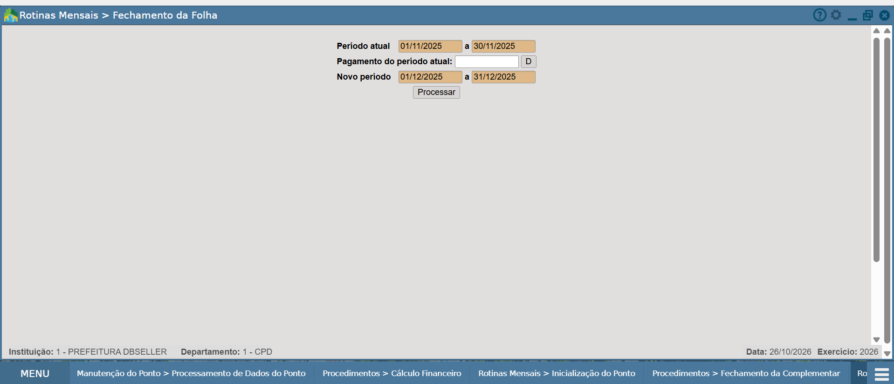
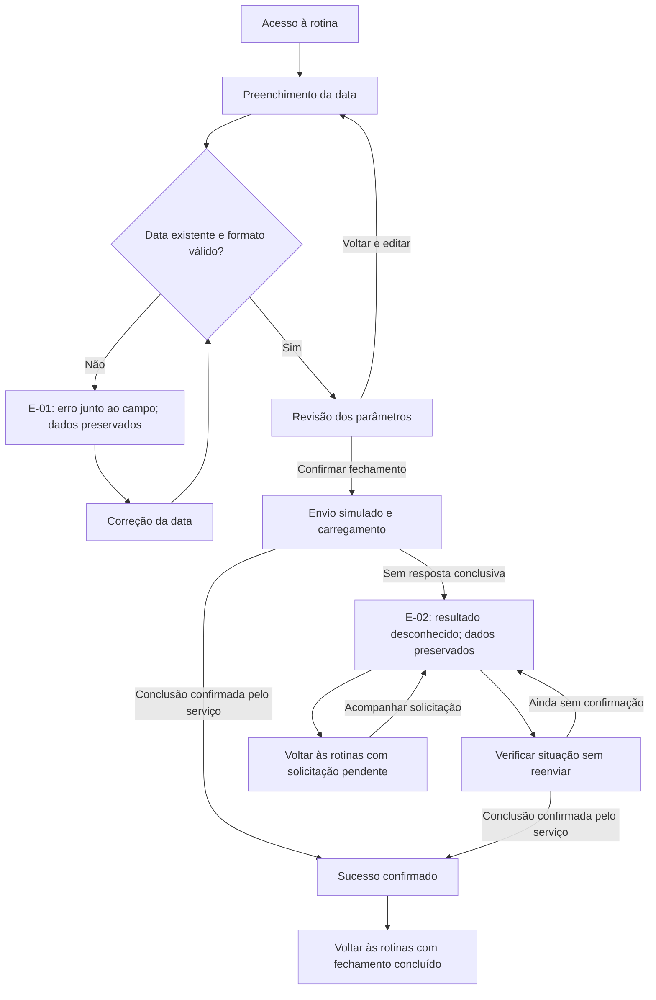
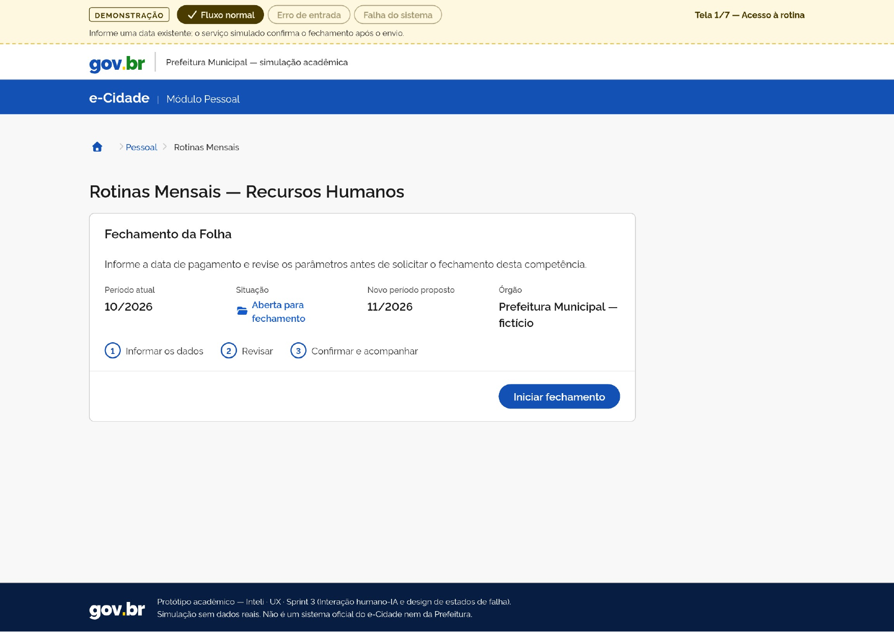
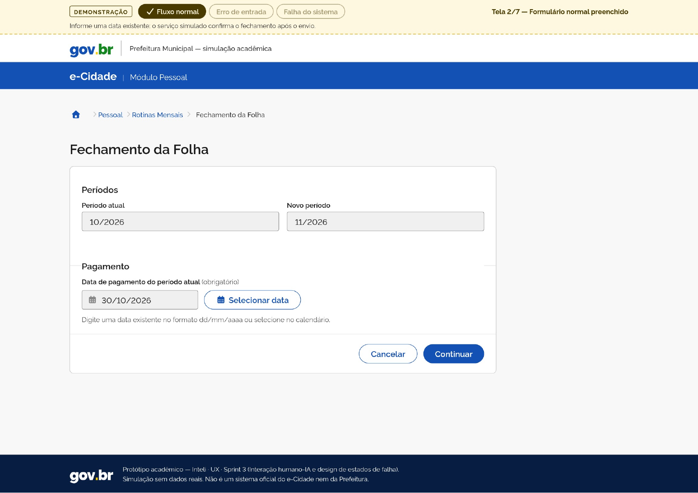
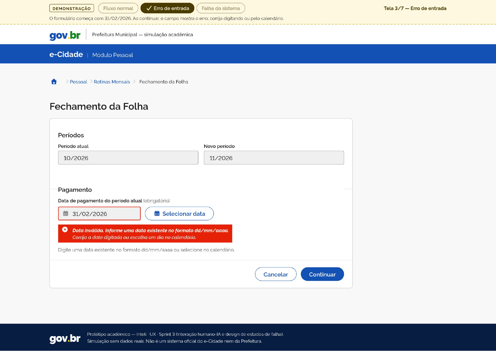
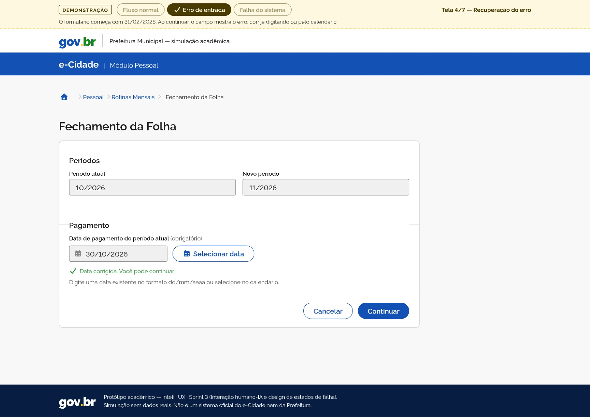
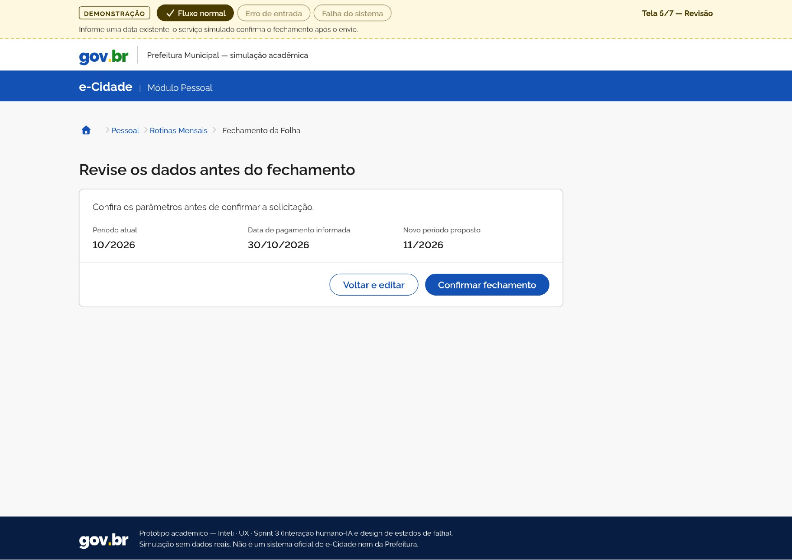
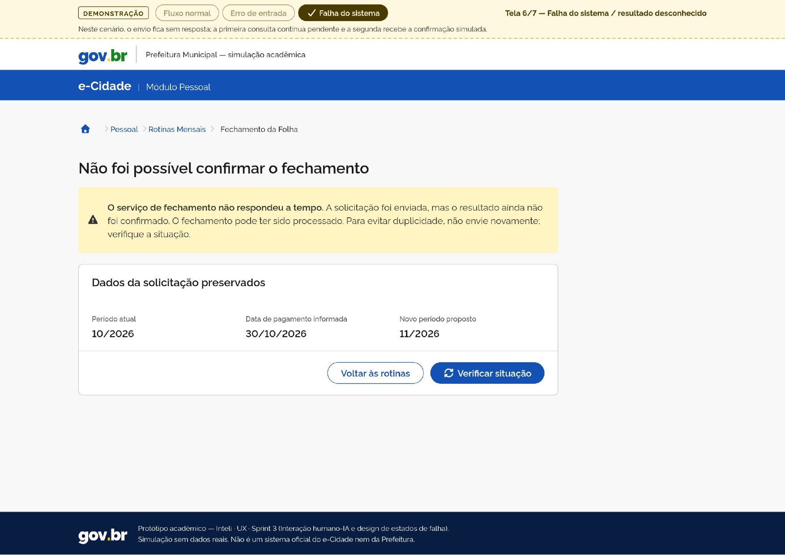
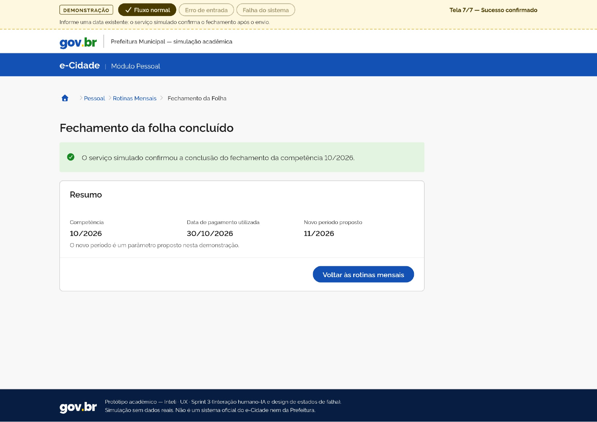

# e-Cidade | Redesign de usabilidade do Fechamento da Folha

Atividade individual de UX · Inteli · Sprint 3 · Interação humano-IA e design de estados de falha.

## Introdução

Dando continuidade à atividade passada, este trabalho propõe uma melhoria na jornada de Folha de Pagamento do e-Cidade, na perspectiva da Prefeitura e do servidor público de RH/Pessoal. O ponto de partida é o problema H-05, identificado na tela de Fechamento da Folha.

O recorte escolhido foi a tela **Fechamento da Folha**, acessada em **Pessoal > Procedimentos > Rotinas Mensais > Fechamento da Folha**. Nela, identificamos o **H-05: Botão com identificação pouco clara**, relacionado à heurística **H2: Correspondência entre o sistema e o mundo real**, de Jakob Nielsen. O controle apresenta somente a letra **D**, sem explicar sua finalidade para quem está preenchendo o formulário.

### Problema identificado na atividade passada

| Aspecto | Registro da avaliação anterior |
| --- | --- |
| Identificador | **H-05: Botão com identificação pouco clara** |
| Etapa | Fechamento da Folha, funcionalidade relacionada à rotina mensal |
| Elemento | Botão identificado pela letra **D** |
| Tela original | Captura da tela original de Fechamento da Folha |
| Descrição | O botão apresenta apenas a letra D, sem uma descrição visível sobre sua finalidade. Isso dificulta a interpretação do controle para quem não conhece previamente seu significado |
| Heurística violada | **H2: Correspondência entre o sistema e o mundo real** |
| Severidade original | **1: Cosmético** |

*Figura 1: Tela original de Fechamento da Folha. Fonte: ambiente de demonstração do e-Cidade, instituição PREFEITURA DBSELLER. [Abrir a captura em tamanho original](assets/origem/fechamento-folha-original.png).*

Na imagem, o botão **D** aparece à direita do campo **“Pagamento do período atual”**, acima de **Processar**. Embora esteja próximo do preenchimento, sua identificação não descreve uma ação. Para compreender o controle, o servidor precisaria conhecer previamente seu significado ou buscar uma explicação fora da tela. Isso contraria a proposta da H2 de apresentar informações e ações em uma linguagem reconhecível para o usuário.

A captura comprova a presença do controle e a ausência de uma descrição explícita. Sua função original não foi verificada. Por isso, o calendário apresentado no redesign é uma **solução proposta**, sem afirmar que o botão D já realizava essa operação no sistema original.

### Da identificação do problema à proposta de melhoria

A partir desse achado, desenvolvemos uma proposta que conecta o problema identificado à experiência de preenchimento, revisão e acompanhamento do fechamento. O recorte foi organizado em uma fatia TO-BE e fundamentado nos componentes do Design System gov.br. Além da clareza do controle, foram trabalhadas duas tratativas de erro para demonstrar como a interface orienta o servidor diante de problemas de origens distintas.

Na proposta, o preenchimento passa a contar com o rótulo **“Data de pagamento do período atual”**, orientação de formato e a ação **“Selecionar data”**. A melhoria não se limita à identificação do controle: o protótipo permite revisar os parâmetros antes do envio, corrigir uma entrada inválida sem perder os dados e acompanhar uma solicitação cujo resultado ainda não foi confirmado.

As decisões de design seguem os princípios discutidos em aula: **mensagens específicas, contexto visível, preservação dos dados, próximos passos claros e feedback que não depende apenas da cor**. O erro de entrada é tratado junto ao campo; a falha de resposta recebe uma tela própria, com resumo preservado e consulta de situação. Assim, a interface orienta tanto o preenchimento quanto a recuperação, mantendo uma estrutura consistente ao longo da jornada.

Esta documentação apresenta a origem do H-05, a fatia TO-BE proposta, as duas tratativas de erro, as escolhas de componentes e as sete telas do protótipo. Os prints estão disponíveis individualmente em `assets/`. Cada imagem é acompanhada da explicação da melhoria e de um registro dos comportamentos e elementos apresentados.

> Os dados e as operações são simulados. O protótipo é uma proposta acadêmica e não executa fechamento no e-Cidade real.

## Acesso rápido

| Item | Link |
| --- | --- |
| Protótipo público (sem login) | [Abrir protótipo no Lovable](https://pixel-to-page-400.lovable.app/) |
| Prints das sete telas | [Ver imagens e explicações](#5-telas-e-estados), com arquivos individuais em `assets/` |
| Gravação de 1min48s | [Vídeo da demonstração](assets/demostra%C3%A7%C3%A3o.mp4) |
| Captura original do legado | [assets/origem/fechamento-folha-original.png](assets/origem/fechamento-folha-original.png) |

---

## 1. Problema identificado e proposta de melhoria

### 1.1 Por que a severidade 1 se mantém

O H-05 apresentado na introdução mantém a severidade original **1: Cosmético**. O problema identificado é a dificuldade de reconhecer a finalidade do controle; o fechamento não foi executado na avaliação anterior, portanto não foi comprovado impedimento à tarefa.

| Fator | Justificativa |
| --- | --- |
| Frequência | Perceptível sempre que o controle é exibido; uso real não foi medido |
| Impacto | Dificuldade de identificar a finalidade, sem impedimento à tarefa comprovado |
| Persistência | O rótulo permanece e não se explica |

Os erros E-01 e E-02 são hipóteses de interação do redesign e **não elevam retroativamente** a severidade do H-05.

### 1.2 Onde a tela entra no blueprint TO-BE

Na análise anterior, o **PF-05**, relacionado ao **H-05**, situava o problema de clareza no **bloco complementar de Fechamento da Folha** do blueprint. Esse é o ponto de partida desta continuação: tornar o controle compreensível e detalhar como o servidor preenche, solicita e acompanha essa rotina.

A tela é detalhada como uma **fatia TO-BE proposta para o Fechamento da Folha**, funcionalidade relacionada à rotina mensal. O recorte começa no acesso à rotina, passa por preenchimento e revisão e termina no acompanhamento do resultado. Não se afirma que o fechamento seja uma etapa confirmada da sequência principal do BPMN.

A ligação entre problema e solução é: **H-05 → clareza do controle de pagamento → validação e correção → revisão e envio → acompanhamento e recuperação**. A matriz abaixo localiza os dois erros propostos nesse percurso.

**Fatia do blueprint TO-BE:** a matriz descreve como a interação foi organizada no protótipo, sem representar uma arquitetura técnica do sistema real.

| Camada | Preenchimento e correção | Revisão e solicitação | Acompanhamento e resultado |
| --- | --- | --- | --- |
| Ação do servidor | Informar a data; corrigir valor impossível | Conferir parâmetros; editar ou confirmar | Consultar situação; voltar às rotinas |
| Frontstage | Label explícito, calendário e erro junto ao campo | Resumo, confirmação e carregamento | Resultado desconhecido com dados preservados, ou conclusão confirmada |
| Backstage proposto | Validar formato e existência da data | Registrar a solicitação na simulação; impedir envio duplicado | Consultar a solicitação existente; manter pendência ou devolver confirmação |
| Suporte / estado | Competência e valores do formulário | Estado da solicitação | Parâmetros e situação preservados na sessão |
| Falha e recuperação | **E-01**: editar o campo sem reiniciar | Sem resposta após o envio leva ao acompanhamento | **E-02**: consultar sem reenviar |

### 1.3 Correção proposta para o H-05

Campo com rótulo **“Data de pagamento do período atual”**, instrução de formato e ação explícita **“Selecionar data”** com ícone. A pessoa digita ou escolhe no calendário. Racional: reduzir memorização de abreviação e usar a linguagem da tarefa. O significado é preservado: **data de pagamento não é data de fechamento**.

| Aspecto | Interface original | Decisão do redesign |
| --- | --- | --- |
| Identificação do controle | Letra D, sem explicação de função | Ação “Selecionar data”, com ícone e nome compreensível |
| Contexto do pagamento | Campo entre dois períodos | Label explícito e ajuda de formato, mantendo a terminologia da tarefa |
| Ação de processamento | Processar visível; comportamento não executado | Revisão antes do envio e acompanhamento do resultado, como proposta TO-BE |
| Tratamento de falhas | Não verificado nessa rotina | Dois cenários simulados; não se afirma que o legado não os possuía |

### 1.4 Sequência de interação

Contexto demonstrativo: período atual **10/2026**, novo período **11/2026**, data válida de referência **30/10/2026**, data inválida do exercício **31/02/2026**. Não se presume que a rotina real abra a competência seguinte nem que o pagamento deva ocorrer dentro da competência atual.

---

## 2. Tratamento dos erros e continuidade da tarefa

O **PF-05/H-05 do bloco complementar do blueprint anterior** fundamenta a escolha da tela. A partir desse ponto, a fatia TO-BE da seção 1.2 detalha dois riscos da interação proposta: informar uma data inexistente e perder a resposta após solicitar o fechamento. **E-01 e E-02 são cenários novos do redesign**, localizados nessa fatia; o PF-05 original descrevia a falta de clareza do controle e não comprova essas falhas no legado. Não foi utilizado um cenário ATAM como origem.

### 2.1 E-01: Erro de entrada: data inexistente

| Aspecto | Decisão |
| --- | --- |
| **Qual erro** | Data impossível, como 31/02/2026 |
| **De onde vem** | Blueprint TO-BE, etapa Preenchimento → validação |
| **Tipo** | **Entrada** (o usuário informa um valor inválido) |
| **O que a tela diz** | “Data inválida. Informe uma data existente no formato dd/mm/aaaa.” + “Corrija a data digitada ou escolha um dia no calendário.” |
| **O que preserva** | Valor digitado, período atual, novo período e contexto da tarefa |
| **Como o usuário segue** | Edita só a data (digitando ou pelo calendário) e continua para a revisão, sem reiniciar |
| **Estado da interface** | Permanece no formulário; campo marcado como inválido, com texto e ícone |

Regras de validação propostas: considerar formato, dias por mês e anos bissextos, sem aceitar data impossível por normalização automática. Não há botão “Validar”: a checagem ocorre ao sair do campo após interação e ao tentar continuar, sem alertar durante a digitação incompleta. Após a correção, o erro desaparece e o feedback é discreto (“Data corrigida. Você pode continuar.”), sem grande alerta verde.

**No protótipo:** [tela 3](assets/tela-3.png), [tela 4](assets/tela-4.png) e trecho **01:30 a 01:44** da [gravação](assets/demostra%C3%A7%C3%A3o.mp4): 31/02/2026 em erro, seleção de 31/03/2026 no calendário e avanço à revisão com os períodos preservados. Complementarmente, 00:54 a 01:09 mostra campo obrigatório vazio com mensagem própria e correção para 24/10/2026.

**Conferência complementar:** a interação no link público rejeitou 31/02/2026, 31/04/2026, 15/13/2026 e 29/02/1900, e aceitou 29/02/2024, 29/02/2000 e 30/10/2026. O campo vazio recebeu mensagem de obrigatoriedade. Esses casos incluem anos bissextos e a exceção dos séculos, sem representar cobertura completa de datas ou auditoria do código. O registro está na seção 6.3.

### 2.2 E-02: Erro do sistema: ausência de resposta após o envio

| Aspecto | Decisão |
| --- | --- |
| **Qual erro** | O serviço simulado não devolve resposta conclusiva depois do envio |
| **De onde vem** | Blueprint TO-BE, etapa Solicitação → acompanhamento |
| **Tipo** | **Sistema** (a falha não depende do que o usuário digitou) |
| **O que a tela diz** | “O serviço de fechamento não respondeu a tempo. A solicitação foi enviada, mas o resultado ainda não foi confirmado. O fechamento pode ter sido processado. Para evitar duplicidade, não envie novamente; verifique a situação.” |
| **O que preserva** | Período atual, data de pagamento, novo período e situação da solicitação |
| **Como o usuário segue** | **Verificar situação** (consulta a solicitação existente, sem novo fechamento); ou **Voltar às rotinas**, onde a pendência aparece como “Resultado não confirmado” com **Acompanhar solicitação** |
| **Se persistir** | Aguardar e procurar o suporte responsável pela rotina antes de nova tentativa |

Explicação à pessoa: o fechamento pode ter sido processado; a ausência de resposta não comprova falha definitiva nem conclusão. A consulta pode continuar sem confirmação, e o sucesso só aparece quando o serviço simulado o retorna explicitamente. Não há reenvio automático, protocolo fictício apresentado como real nem promessa de prazo. A incerteza é comunicada como tal: não é dado estimado nem provisório. Também **não** se trata de indisponibilidade anterior ao envio.

Para ser reproduzível, a simulação usa uma sequência acadêmica: **a primeira consulta permanece pendente e a segunda recebe confirmação**. Isso não representa regra real de recuperação do e-Cidade.

**No protótipo:** [tela 6](assets/tela-6.png) e trecho **01:05 a 01:23** da gravação (envio com 24/10/2026, resultado desconhecido, consulta com carregamento, pendência mantida e retorno às rotinas com “Acompanhar solicitação”). Na verificação pelo link público, a primeira consulta permaneceu pendente e a segunda apresentou “A situação foi consultada e a conclusão foi confirmada. A solicitação não foi reenviada.” O retorno manteve o fechamento concluído e a ação Consultar resumo.

**Limite:** a interface não ofereceu novo envio nesse percurso, mas o mecanismo interno contra duplicidade e as requisições não foram auditados sem acesso ao código. A gravação mostra só a primeira consulta pendente.

### 2.3 Comparação

| | E-01 | E-02 |
| --- | --- | --- |
| Tipo | Entrada | Sistema |
| Causa | Valor digitado impossível | Falta de resposta do serviço |
| Controle do usuário | Total: corrige o campo | Parcial: consulta e aguarda |
| Risco evitado | Aceitar data inexistente | Fechamento duplicado |
| Tom da mensagem | Corretivo, junto ao campo | Explicativo, com tela própria |
| Cor semântica | Vermelho + ícone + texto | Atenção + ícone + texto |

---

## 3. Decisões de interface e Design System gov.br

O [Design System gov.br](https://www.gov.br/ds/) orientou a escolha dos componentes e dos estados. A conferência no protótipo público identificou o CSS `core.min` e as classes `br-header`, `br-breadcrumb`, `br-input`, `br-button`, `br-message`, `br-loading`, `br-card` e `br-footer`. Foram verificadas as variantes `warning` e `success` nas mensagens e `primary` e `secondary` nos botões. A família de fonte declarada no estilo computado é Rawline.

O uso dessas classes e estilos foi conferido na interface carregada. A versão v3 de `@govbr-ds/core` foi informada pelo gerador, sem confirmação independente do número da versão. O calendário usa classes próprias com prefixo `ec-cal`, em vez da implementação oficial de DateTimePicker; essa adaptação é explicada na seção 3.3. Não foi realizada auditoria integral das estruturas e dependências.

### 3.1 Por que cada componente

| Componente | Onde | Por que este componente | Estados cobertos |
| --- | --- | --- | --- |
| [Header](https://www.gov.br/ds/components/header) | Todas as telas | Identifica o módulo e mantém a referência institucional | Sem controles fictícios |
| [Breadcrumb](https://www.gov.br/ds/components/breadcrumb) | Acesso e rotina | Situa a tarefa em Pessoal > Rotinas Mensais | Localização atual e retornos coerentes |
| [Input](https://www.gov.br/ds/components/input) | Formulário | Associa rótulo, valor, ajuda e erro ao mesmo campo | Normal, foco, somente leitura, erro |
| Calendário personalizado, com referência no [DateTimePicker](https://www.gov.br/ds/components/datetimepicker) | Data de pagamento | Mantém digitação e seleção no mesmo formulário, com ação “Selecionar data”; adaptação própria declarada | Abertura e seleção por ponteiro; avanço com seta, seleção com Enter e fechamento com Escape conferidos |
| [Button](https://www.gov.br/ds/components/button) | Todas as etapas | Separa ação principal (Confirmar, Verificar situação) de secundária (Voltar e editar, Voltar às rotinas) | Foco, acionamento, desabilitado no processamento |
| [Message](https://www.gov.br/ds/components/message) | Validação e resultados | Explica o estado e indica o próximo passo | Erro, resultado desconhecido, sucesso |
| [Loading](https://www.gov.br/ds/components/loading) | Envio e consulta | Informa processamento e reduz cliques repetidos | Com texto; sem porcentagem inventada |
| [Card](https://www.gov.br/ds/components/card) | Contexto, formulário, resumo | Agrupa informações da mesma tarefa | Hierarquia e legibilidade |

### 3.2 Cor nunca sozinha

Paleta, conforme a [referência de tokens](https://govbr-ds.gitlab.io/tools/govbr-ds-wiki/referencias/tokens/): `--blue-warm-vivid-70` (`#1351B4`) em ações e identidade; `--blue-warm-vivid-90` (`#071D41`) em tons escuros de apoio; `--gray-2` (`#F8F8F8`) no fundo; `--gray-80` (`#333333`) no texto. Fonte-base: Rawline.

| Estado | Cor | Ícone | Texto que carrega o significado |
| --- | --- | --- | --- |
| E-01 Entrada inválida | Vermelho | Sim (visível na tela 3) | “Data inválida. Informe uma data existente…” |
| Correção | Texto verde discreto, sem faixa de sucesso | Marca de confirmação visível na tela 4 | “Data corrigida. Você pode continuar.” |
| E-02 Resultado desconhecido | Atenção (amarelo) | Alerta visível na tela 6 | “O serviço de fechamento não respondeu a tempo” e explicação de resultado desconhecido |
| Sucesso confirmado | Verde | Confirmação visível na tela 7 | “O serviço simulado confirmou a conclusão do fechamento da competência 10/2026.” |

Em todos os estados, retirar a cor não muda o entendimento: o texto diz o que houve e a ação disponível.

### 3.3 Necessidades de composição, adaptações e decisões

O DS fornece os componentes de mensagem, formulário, botão e carregamento. A decisão específica desta jornada é **como combiná-los quando o resultado de uma operação permanece desconhecido**: qual informação preservar, quando permitir a consulta e em que momento apresentar sucesso. Um Message isolado não define essas regras do fechamento; por isso, a composição foi especificada na fatia TO-BE.

| Necessidade da jornada | Decisão | Justificativa |
| --- | --- | --- |
| Comunicar **resultado desconhecido** e oferecer recuperação na rotina | Compor Message de atenção, resumo e ação “Verificar situação” | Há falha de resposta, mas não se sabe se a operação foi concluída; o texto explica a distinção e orienta a não reenviar |
| Integrar **calendário** e manter a ação “Selecionar data” legível | Calendário próprio, aberto no fluxo do formulário, abaixo do campo | Mantém o preenchimento e a correção no mesmo contexto. A conferência encontrou o calendário dentro da largura disponível em 390, 768 e 1440 px e verificou setas, Enter e Escape |
| **Revisão antes de confirmar** | Página com resumo + Card + Button, sem modal que repita a decisão | Evita confirmação duplicada e mantém Voltar e editar visível |
| **Acompanhar solicitação pendente** nas rotinas | Texto de situação (“Resultado não confirmado”) com ação no mesmo contexto | Permite retomar sem criar novo envio |
| **Faixa de cenários acadêmicos** | Faixa separada da interface de RH, com “Trocar cenário”/“Manter” | Ferramenta da simulação, não funcionalidade do e-Cidade |
| **Registro das telas** | Prints individuais, fora das ações administrativas | Cada imagem em `assets/` registra um estado e é explicada na seção 5 |

**Escolha do calendário:** o requisito central da demonstração do E-01 é **aceitar e preservar o texto inválido `31/02/2026` até que o servidor o corrija**, sem apagar o valor, substituí-lo automaticamente ou perder os períodos preenchidos. O calendário próprio foi mantido para integrar esse campo à ação **Selecionar data**, aberta abaixo dele, e permitir a correção por digitação ou seleção no mesmo formulário. A escolha prioriza a continuidade entre erro e recuperação, apresentada nas telas 3 e 4.

O [DSGov oferece um DateTimePicker](https://www.gov.br/ds/components/datetimepicker); a adaptação é uma decisão desta demonstração, não uma lacuna do DS. Não foi realizada comparação que demonstrasse impossibilidade de atender a esses requisitos com o componente oficial. O custo assumido é manter foco, teclado e validação na implementação própria. Os percursos conferidos estão na seção 6.4; para uma implementação definitiva, cabe avaliar o componente oficial antes de manter esse custo.

---

## 4. Recuperação em diferentes momentos da jornada

O protótipo trata **dois erros de tipos distintos** em dois momentos diferentes da jornada:

| | 1ª tratativa: E-01 | 2ª tratativa: E-02 |
| --- | --- | --- |
| Tipo | Entrada | Sistema |
| Telas | 3 e 4 | 6 e estado de sucesso após consulta; a imagem 7 registra o sucesso do fluxo normal |
| Interação | Editar o campo e escolher data no calendário | Verificar situação (primeira consulta pendente, segunda confirmada), voltar às rotinas e Acompanhar solicitação |
| Recuperação | Imediata, no próprio formulário | Por consulta, **sem reenviar** |

A segunda tratativa é interativa e demonstrada na gravação (01:05 a 01:23) e no link público (conclusão após a segunda consulta), com carregamento, pendência mantida, retorno às rotinas e reabertura do contexto preservado.

---

## 5. Telas e estados

As sete telas são apresentadas por meio dos prints individuais em `assets/`, sem documento consolidado. Erro e recuperação são estados do mesmo formulário.

| Nº | Tela/estado | Informação e ação essenciais | Print em assets |
| --- | --- | --- | --- |
| 1 | Acesso à rotina | Contexto de RH, competência, Iniciar fechamento | [Tela 1](assets/tela-1.png) |
| 2 | Formulário normal | Períodos, data de pagamento, Selecionar data | [Tela 2](assets/tela-2.png) |
| 3 | Erro de entrada (E-01) | Data impossível, mensagem próxima, possibilidade de editar | [Tela 3](assets/tela-3.png) |
| 4 | Recuperação | Data corrigida, dados preservados, continuidade | [Tela 4](assets/tela-4.png) |
| 5 | Revisão | Resumo, Voltar e editar, Confirmar fechamento | [Tela 5](assets/tela-5.png) |
| 6 | Resultado desconhecido (E-02) | Resumo preservado, Verificar situação | [Tela 6](assets/tela-6.png) |
| 7 | Sucesso confirmado | Confirmação do serviço simulado, parâmetros, retorno às rotinas | [Tela 7](assets/tela-7.png) |

A confirmação do usuário autoriza o envio; **não equivale à confirmação de conclusão pelo serviço**.

### 5.1 Tela 1: Acesso à rotina

*Figura 2: Entrada da rotina e contexto antes do início.*

O servidor reconhece a tarefa e a competência antes de agir. O card reúne período, situação, novo período proposto e órgão fictício; as três etapas antecipam o percurso. **Iniciar fechamento** conduz ao formulário.

Manter o contexto junto à ação evita depender de memória para saber sobre qual competência se está trabalhando. Cabeçalho, breadcrumb e rodapé formam a estrutura estável da jornada. A faixa de demonstração fica separada das ações administrativas.

### 5.2 Tela 2: Formulário normal: melhoria do H-05

*Figura 3: Controle de pagamento redesenhado.*

O formulário permite informar a data de pagamento sem precisar interpretar a letra D. O rótulo **“Data de pagamento do período atual”**, a indicação de obrigatoriedade, a instrução **dd/mm/aaaa** e o botão **“Selecionar data”** tornam o preenchimento compreensível. **Continuar** leva à revisão quando o valor é válido; **Cancelar** permite retornar.

Separar “Períodos” e “Pagamento” em seções do mesmo card mantém o contexto e distingue o dado a preencher. O texto do botão expressa uma ação, e o ícone reforça seu significado. Essa é a resposta direta à **H2: Correspondência entre sistema e mundo real**, preservando a terminologia do campo original.

### 5.3 Tela 3: Erro de entrada: data impossível (E-01)

*Figura 4: Validação da data impossível no próprio formulário.*

O servidor pode identificar e corrigir uma entrada inválida sem abandonar a tarefa. A data **31/02/2026** continua no campo, enquanto a mensagem explica o problema e oferece digitação ou calendário como caminhos de correção.

Aproximar erro e campo reduz a procura pela causa. Borda, ícone e texto comunicam o estado de forma redundante. A mensagem trata o valor informado, sem culpar a pessoa, e não apaga os períodos. A próxima ação é corrigir a data no mesmo formulário.

### 5.4 Tela 4: Recuperação sem perda de contexto

*Figura 5: Formulário após a correção para uma data existente.*

A correção resolve o erro sem reiniciar a jornada. Após a alteração para **30/10/2026**, o alerta vermelho desaparece; a mensagem **“Data corrigida. Você pode continuar.”** orienta a continuidade. Os períodos continuam iguais aos da tela anterior.

Preservar a estrutura do formulário e usar feedback discreto evita transformar uma correção local em uma nova etapa burocrática. Não é necessário clicar em um botão separado de validação. **Continuar** permite seguir à revisão.

### 5.5 Tela 5: Revisão e decisão antes do envio

*Figura 6: Conferência dos parâmetros antes da solicitação.*

A revisão permite ao servidor conferir exatamente o que será solicitado. O resumo apresenta período atual, data informada e novo período proposto. **Voltar e editar** permite corrigir; **Confirmar fechamento** autoriza o envio simulado.

O resumo reduz a necessidade de lembrar o preenchimento anterior e mantém a pessoa no controle. A página já é uma etapa de revisão, por isso não foi acrescentado outro modal para repetir a mesma confirmação. Após confirmar, há carregamento; a decisão do usuário ainda não é uma prova de conclusão do serviço.

### 5.6 Tela 6: Falha de resposta e resultado desconhecido (E-02)

*Figura 7: Segunda tratativa: falha do sistema após o envio.*

A tela explica o que se sabe e o que ainda não se sabe. A interface informa que o serviço não respondeu a tempo, que a solicitação foi enviada e que o resultado não foi confirmado. Não conclui que o fechamento falhou nem que terminou.

**Mensagem apresentada:** “O serviço de fechamento não respondeu a tempo. A solicitação foi enviada, mas o resultado ainda não foi confirmado. O fechamento pode ter sido processado. Para evitar duplicidade, não envie novamente; verifique a situação.”

O Message de atenção, com texto e ícone, fica acima do resumo preservado. A ação principal é **Verificar situação**, enquanto **Voltar às rotinas** mantém um caminho de acompanhamento. Isso aplica a ideia de degradação graciosa: a interface continua útil para consultar e preservar o contexto, sem fingir uma conclusão e sem induzir novo envio.

O vídeo mostra a primeira consulta pendente. A segunda consulta com confirmação foi verificada diretamente no protótipo público e está registrada na seção 6.3.

### 5.7 Tela 7: Sucesso confirmado e encerramento da tarefa

*Figura 8: Resultado confirmado no fluxo normal.*

O resultado permite reconhecer a conclusão e conferir os parâmetros utilizados. A mensagem cita explicitamente o **serviço simulado**, apresenta ícone e texto de sucesso e mantém o resumo. **Voltar às rotinas mensais** encerra esse percurso.

Reservar a confirmação de sucesso para a resposta conclusiva evita confundir “enviei” com “foi concluído”. O novo período continua identificado como parâmetro proposto, sem alegar abertura real de outra competência.

A captura registra o **fluxo normal**, não a recuperação de E-02. Após consultar uma solicitação inicialmente sem resposta, a tela de sucesso acrescenta que a situação foi consultada e a solicitação não foi reenviada; esse comportamento foi conferido pelo link público. O retorno com situação concluída também aparece na gravação.

---

## 6. Navegação e verificação do protótipo

### 6.1 Roteiro de navegação

1. **Fluxo normal:** escolher o cenário na faixa acadêmica, iniciar, preencher uma data existente, revisar, confirmar, aguardar e conferir o resumo.
2. **E-01:** escolher o cenário antes de iniciar, tentar continuar com 31/02/2026, corrigir e seguir sem perder dados.
3. **E-02:** confirmar o envio, ver o resultado desconhecido e clicar em Verificar situação (1ª consulta pendente, 2ª confirmada).
4. **Retorno:** após sucesso, consultar o resumo; se pendente, Acompanhar solicitação sem novo envio.

Trocar de cenário com dados existentes mostra “Trocar cenário” e “Manter”, avisando que a simulação será reiniciada. Esse descarte é local e não representa cancelamento de operação municipal.

### 6.2 O que a gravação permite observar

Intervalos aproximados do arquivo de 1min48s; análise visual, não auditoria do código.

| Intervalo | O que acontece | Alcance da gravação |
| --- | --- | --- |
| 00:00 a 00:16 | Calendário, seleção de 09/12/2026 e avanço à revisão | Já contém contexto anterior; data diferente da dos prints |
| 00:16 a 00:30 | Envio, sucesso, “Fechamento concluído” e Consultar resumo | Caminho normal, não recuperação |
| 00:31 a 00:48 | Erro de entrada, seleção de 13/02/2026 e continuidade | Data alterada antes de demonstrar o erro |
| 00:54 a 01:09 | Troca de cenário, campo obrigatório, correção para 24/10/2026 e envio | Erro adicional ao de data impossível |
| 01:09 a 01:23 | Resultado desconhecido, consulta, pendência e Acompanhar solicitação | Não mostra a 2ª consulta |
| 01:30 a 01:44 | 31/02/2026 corrigido para 31/03/2026 pelo calendário e revisão | Não prova todas as regras nem teclado |

### 6.3 Verificação pelo link público

O [protótipo público](https://pixel-to-page-400.lovable.app/) foi aberto em Chrome, em perfil temporário e sem autenticação. A interação foi automatizada pelo protocolo do navegador. O registro abaixo reúne os percursos e resultados conferidos, sem depender de um arquivo externo de verificação.

| Conferência | Resultado |
| --- | --- |
| Acesso público | Carregamento e interação sem login ou sessão do autor |
| Solicitação no cenário Falha do sistema | Revisão, confirmação e resultado desconhecido com os três parâmetros preservados |
| Primeira consulta | Situação ainda pendente |
| Segunda consulta | Conclusão confirmada com a mensagem “A situação foi consultada e a conclusão foi confirmada. A solicitação não foi reenviada.” |
| Retorno após conclusão | Situação “Fechamento concluído” e ação Consultar resumo |
| Datas impossíveis | 31/02/2026, 31/04/2026 e 15/13/2026 rejeitadas, mantendo o formulário |
| Anos bissextos | 29/02/2024 e 29/02/2000 aceitas; 29/02/1900 rejeitada |
| Data válida de referência | 30/10/2026 aceita e apresentada na revisão |
| Campo vazio | Mensagem “Informe a data de pagamento no formato dd/mm/aaaa.” |

Nos casos aceitos, o avanço ocorreu até a revisão. Nos casos inválidos, o foco foi direcionado ao campo de pagamento e o valor foi preservado para correção.

**Alcance:** as conferências são próprias desta revisão e não usam os testes Vitest ou Playwright declarados pelo gerador. Não há código-fonte anexado, nem auditoria das requisições ou do mecanismo interno contra duplicidade. A amostra de datas não representa cobertura completa da validação.

### 6.4 Consistência e acessibilidade

Padrões mantidos entre telas: identidade institucional, componentes, significado das cores, tom das mensagens, hierarquia das ações e comportamento dos estados de falha. Termos de RH (competência, período, data de pagamento) foram usados sem inventar regras de negócio.

| Aspecto conferido | Resultado e alcance |
| --- | --- |
| Associação de rótulos | Os rótulos apontam para `periodo-atual`, `novo-periodo` e `data-pagamento` |
| Identificação do erro | Campo com `aria-invalid="true"` e `aria-describedby="data-help data-erro"` após tentativa inválida |
| Foco no campo | Retorno ao campo inválido; estilo de foco com contorno por sombra de 2 px |
| Abertura do calendário | Foco inicial no dia selecionado; grade e dias com nomes acessíveis |
| Teclado no calendário | Seta para a direita moveu o foco de 30 para 31; Enter selecionou 31/10/2026, fechou o calendário e devolveu o foco ao campo |
| Fechamento sem seleção | Escape fechou o calendário e devolveu o foco ao botão Selecionar data |
| Larguras de tela | No formulário com calendário aberto, 390, 768 e 1440 px não produziram rolagem horizontal do documento; grade e ações verificadas ficaram dentro da área disponível |
| Contraste das ações | Branco sobre azul `#1351B4`, e o inverso, com razão calculada de **7,33:1** nos botões Continuar e Selecionar data |
| Comunicação independente da cor | Mensagens de erro e resultado com texto e ícone, conforme os prints |
| Contexto preservado | Períodos mantidos ao corrigir, revisar e consultar o resultado |

Esses resultados cobrem os elementos e percursos descritos. Não houve auditoria com leitor de tela, navegação integral por Tab, ampliação ou medição de todos os pares de cores. A emulação das três larguras não substitui teste em dispositivos físicos nem comprova todas as telas responsivas. A semântica acessível completa permanece fora do alcance desta conferência.

---

## 7. Entrega e checklist

| Material | Conteúdo |
| --- | --- |
| [Prints das sete telas](#5-telas-e-estados) | Arquivos `assets/tela-1.png` a `assets/tela-7.png`, apresentados um por um na seção 5 |
| [Vídeo](assets/demostra%C3%A7%C3%A3o.mp4) | Fluxos analisados na seção 6.2 |
| [Captura original](assets/origem/fechamento-folha-original.png) | Tela com o campo de pagamento e o botão D |

Não há aplicação executável nem código-fonte do protótipo neste repositório; não são necessários comandos de instalação.

- [x] H-05, H2, severidade 1, vínculo PF-05 e fatia TO-BE documentados
- [x] Duas tratativas de tipos diferentes (entrada e sistema), com mensagem, dados preservados e recuperação
- [x] Sete prints distintos em `assets/`, apresentados individualmente, e gravação incorporada
- [x] Cor sempre acompanhada de texto (e ícone)
- [x] Composição dos componentes do DS e adaptação do calendário explicadas
- [x] Link do protótipo com acesso verificado sem sessão do autor
- [x] Classes do Core DSGov e referência à família Rawline conferidas na interface pública
- [x] Casos de datas válidas, impossíveis, bissextas e campo vazio conferidos
- [x] Teclado do calendário, foco, contraste das ações e três larguras conferidos no recorte da seção 6.4

**Envio da atividade:** ainda cabe ao autor disponibilizar este repositório, conferir seu acesso em aba anônima e enviar o link no Adalove. O acesso público verificado acima se refere ao protótipo; a submissão acadêmica não foi realizada nesta revisão.

## 8. Revisão da geração por IA

A IA foi usada na construção e revisão do protótipo e no apoio à redação; **não há funcionalidade de IA para o servidor**. A revisão abaixo não é teste de usabilidade nem design critique com colega (dispensado pela docente, conforme informado pelo autor; nenhum comentário é atribuído a terceiros).

| Observação nas versões analisadas | Decisão | Situação |
| --- | --- | --- |
| Vídeo inicial voltava à competência aberta após sucesso | Manter o resultado e impedir repetição do fechamento | “Fechamento concluído” e Consultar resumo na gravação atual |
| Rótulo “Data do fechamento simulado” | Restaurar o significado: data de pagamento do período atual | Correto nas telas 2 a 6 |
| Respostas configuradas a cada passo | Escolher cenário antes e consultar naturalmente | Sem painel técnico na gravação atual |
| Faixa verde “Data válida” | Feedback discreto e remoção do erro | Tela 4 |
| Imagens ausentes no cabeçalho e rodapé | Corrigir ou usar identificação textual | Novas capturas sem placeholders |
| Troca de cenário pouco evidente | Confirmação de descarte | “Trocar cenário” e “Manter”; sem teste de compreensão |
| Exportações anteriores repetiam a mesma tela | Apresentar os prints individualmente | Sete imagens diferentes em `assets/`, explicadas na seção 5 |

## 9. Referências

- Material da atividade **T17 (ES08) [2 ano]: S3: Interação humano-IA e design de estados de falha** (não anexado).
- [Captura original de Fechamento da Folha](assets/origem/fechamento-folha-original.png), ambiente de demonstração do e-Cidade.
- [Design System gov.br: portal](https://www.gov.br/ds/) e [referência de tokens](https://govbr-ds.gitlab.io/tools/govbr-ds-wiki/referencias/tokens/).
- Componentes: referências oficiais na seção 3.1.
